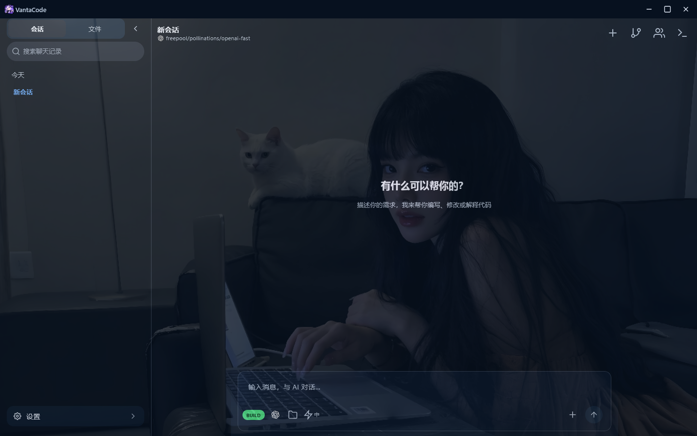
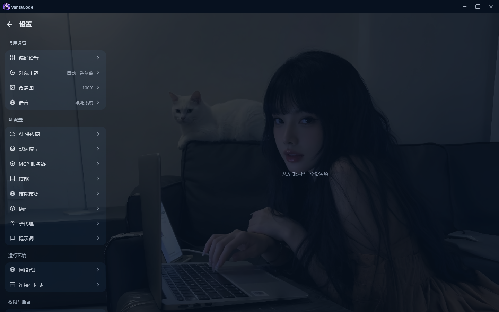
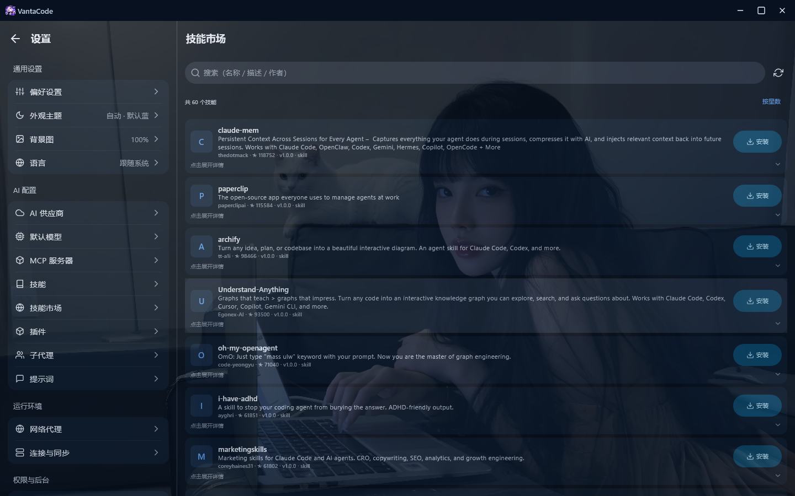
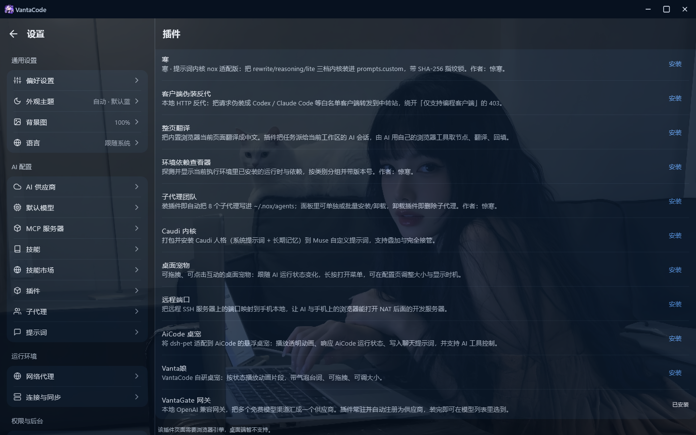
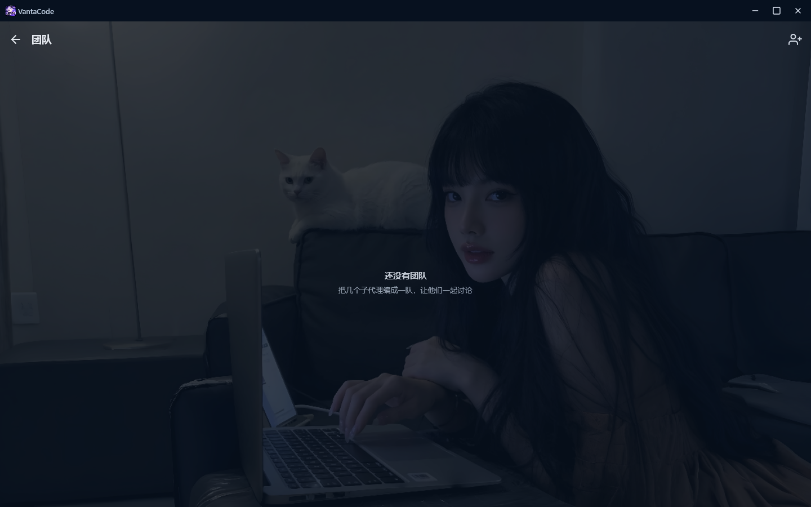
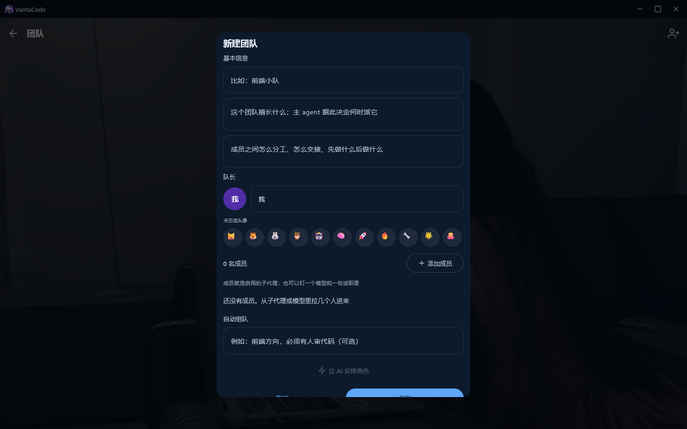

<p align="center">
  
  <h1 align="center">VantaCode Desktop</h1>
  <p align="center">
    AiCode 的 Windows 桌面移植 · Kotlin + Compose Multiplatform
    <br />
    通用 AI Coding Agent：对话 · 终端 · Git · 代理会话
  </p>
</p>

<p align="center">
  <a href="LICENSE"></a>
  
  
</p>

## 这是什么

**VantaCode Desktop** 是 [AiCode](https://github.com/jieapi/AiCode)（Android 上的通用 AI Coding Agent，GPL-3.0）的桌面端独立移植与复刻，使用 **Kotlin + Compose Multiplatform Desktop** 构建，**Windows 优先**。

它不是把 Android 版换个壳跑在电脑上，而是把 AI 编程代理的能力整体重构并下移到桌面：AI 对话与代理会话、Git 集成、内置终端（PTY）、工作区 / 远程 SSH、模型与 MCP 配置、主题与背景、备份与还原等，都以原生桌面应用的形式提供。

- 上游项目：**[AiCode](https://github.com/jieapi/AiCode)**（Android 上的通用 AI Coding Agent）
- 本仓库是 AiCode 的桌面移植与复刻，许可证完全一致：**GPL-3.0**（见 [LICENSE](LICENSE)）
- 版权声明与第三方组件说明：[NOTICE](NOTICE)
- 上游原 README（含上游声明）：[docs/upstream-README.md](docs/upstream-README.md) / [English](docs/upstream-README.en.md)

## 下载与安装

前往 **[Releases](https://github.com/Hye-steam/VantaCode-Desktop/releases)** 下载最新版：

- **VantaCode-1.4.0.exe**（402.3 MB，Windows x64 安装包，安装时会弹出 GPL 许可接受页）
- 运行后首次启动会自动解包内置 ffmpeg 到 `%USERPROFILE%\.vantacode\tools\ffmpeg\`（约 100 MB，仅一次），用于 MP4 动态背景高帧率解码，**无需手动安装 ffmpeg**
- 应用数据目录：`%USERPROFILE%\.vantacode`（日志、数据库、缓存）
- 代理配置目录：`%USERPROFILE%\.aicode`（agents、prompts、scripts 等）

构建校验信息（v1.4.0）：

| 项 | 值 |
|---|---|
| 文件名 | `VantaCode-1.4.0.exe` |
| 大小 | 421,829,632 字节（402.3 MB） |
| SHA-256 | `E18BF0962440FBDB68360F197C646504D1B43FD5F31F23ACDD58EE102B03F244` |

## 功能一览

- AI 对话与代理会话主界面（多模型、多供应商）
- 内置终端（PTY，pty4j）与代码编辑场景
- Git 视图（提交历史、分支管理）
- 工作区 / 远程 SSH（sshj）连接你自己的服务器
- 模型、MCP、主题、背景设置（支持 GIF / MP4 动态背景）
- 备份与还原（本地 / S3 / WebDAV / SSH 目标）、凭据管理
- LaTeX 数学渲染
- Teams：多成员 AI 团队协作（定义 / 聊天 / 编辑器）
- 内置 ffmpeg（essentials 构建），随应用自动解包，开箱即用

## 界面预览

<p align="center">
  
  
</p>
<p align="center">
  
  
</p>
<p align="center">
  
  
</p>

## 已移植与未移植

已移植：AI 对话主界面、代理会话、Git 视图、工作区 / 远程 SSH、设置（模型、MCP、主题、背景）、备份 / 还原、凭据管理、LaTeX 渲染、终端（PTY）、技能市场、更新检查、内置代码编辑器、完整插件系统（含 JCEF 面板渲染）。

未移植 / 受限：

- Android 专属能力（Proot、Shizuku、APK 内升级、唤醒锁、通知栏）已删除，不计划回移植
- 移动端布局相关设置已裁剪
- 安装包仅提供 EXE（MSI 暂不提供）

## 从源码构建（Windows x64，JDK 21）

要求：JDK 21、Git、8 GB 以上内存（关闭占用内存的应用可显著加快构建）。

```powershell
# 仓库根目录 .jdk 为示例构建 JDK 21
$env:JAVA_HOME = "$PWD\.jdk"

# 编译并生成 app image（免 WiX；便携目录）
.\gradlew.bat :desktop:createDistributable --console=plain
# 产物：desktop\build\compose\binaries\main\app\VantaCode\VantaCode.exe

# 生成 EXE 安装包（需先安装 WiX 3.11，或配置 wix311.zip 缓存）
.\gradlew.bat :desktop:packageExe --console=plain
# 产物：desktop\build\compose\binaries\main\exe\VantaCode-<version>.exe
```

若网络环境受限，可将 `wix311-binaries.zip` 放到 `%USERPROFILE%\.gradle\compose-jb\wix311.zip`，Gradle 任务会跳过下载直接解包。

版本号维护（`VERSION_NAME` / `VERSION_CODE` / `packageVersion` 三处同步）：

```powershell
node scripts\bump-version.js
```

## 许可与源代码获取（GPL-3.0）

本程序是自由软件：你可以重新分发和修改它，条件是遵守 GPL-3.0 的全部条款。分发本程序必须保留 LICENSE 与 NOTICE 文件，并以 GPL-3.0 向接收者提供对应源代码。

- 完整许可证文本：[LICENSE](LICENSE)
- 第三方组件、字体、库及其许可：[NOTICE](NOTICE)
- **对应源代码**：本仓库即 VantaCode Desktop 的源代码树；Release 中的 EXE 与本仓库的源代码同源（构建标签见 Release 说明）
- 本仓库复用了 AiCode 上游代码并以 GPL-3.0 发布，任何分发衍生作品必须同样遵守 GPL-3.0，并保留版权与许可声明

## 社区

QQ 群：**1094669183**

---

## English

**VantaCode Desktop** is an independent desktop port of [AiCode](https://github.com/jieapi/AiCode) (a general-purpose AI coding agent for Android, GPL-3.0), built with Kotlin + Compose Multiplatform Desktop, primarily for Windows. It brings the agent experience to the desktop: AI chat, agent sessions, Git view, embedded PTY terminal, workspaces / remote SSH, model & MCP settings, GIF/MP4 animated backgrounds (bundled ffmpeg, auto-extracted on first run), Teams collaboration, and a draggable desktop pet.

- License: GPL-3.0 (see [LICENSE](LICENSE) / [NOTICE](NOTICE))
- Corresponding source: this repository; the EXE in [Releases](https://github.com/Hye-steam/VantaCode-Desktop/releases) is built from this source
- Upstream project: [jieapi/AiCode](https://github.com/jieapi/AiCode)
